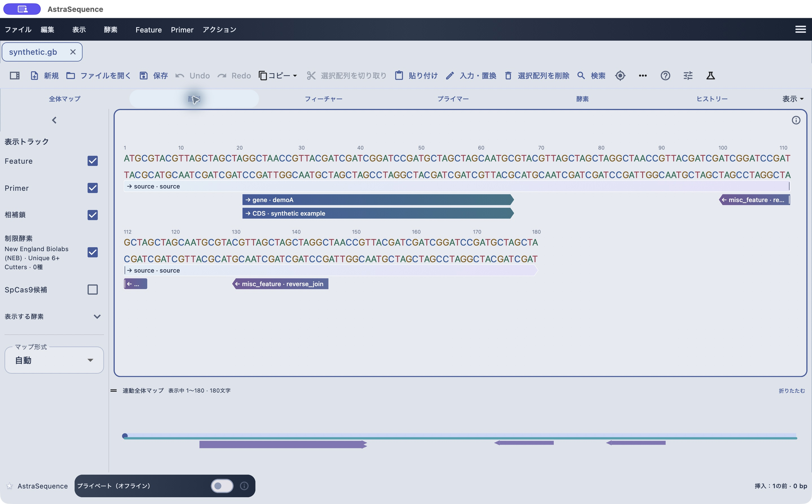

# AstraSequence アプリマニュアル

DNA・RNA・タンパク配列の確認・編集から、注釈、PCR、マルチプルアライメントまでを説明する日本語マニュアルです。対象は **AstraSequence 0.84.0**、更新日は2026年11月5日です。

*画面例は0.79.2のmacOS実機。画像ごとの撮影版と確認範囲は[画面の出典](docs/platform-status.md)を参照してください。*

初めて使う方は1〜3、アライメントを行う方は8〜9を順にお読みください。画像はクリックして拡大できます。

| 章 | 操作 |
|---|---|
| 1 | [配列を開き、選択して保存する](docs/getting-started.md) |
| 2 | [完全保存と書き出し](docs/saving.md) |
| 3 | [選択・検索・編集と表示調整](docs/editing.md) |
| 4 | [Feature・セグメント・CDS翻訳](docs/features.md) |
| 5 | [Primer登録とPCR](docs/primers.md) |
| 6 | [供給元とグループで制限酵素を選ぶ](docs/enzymes.md) |
| 7 | [消化・接合・クローニング](docs/cloning.md) |
| 8 | [核酸・タンパクのマルチプルアライメント](docs/alignment.md) |
| 9 | [アライメント結果の見方・保存・交換](docs/alignment-viewer.md) |
| 10 | [困ったとき・用語集](docs/troubleshooting.md) |
| 11 | [5 Mbまでの大きな配列を閲覧する](docs/large-sequences.md) |

[画面の出典・対応範囲](docs/platform-status.md) · [練習用データ](examples/README.md) · [主な操作](docs/whats-new.md) · [問い合わせ](https://github.com/PtBio/AstraSequence/issues)

## SkyAccess

開発中。

[ブランド素材について](BRAND-NOTICE.md)。このリポジトリは公開ガイド用です。
