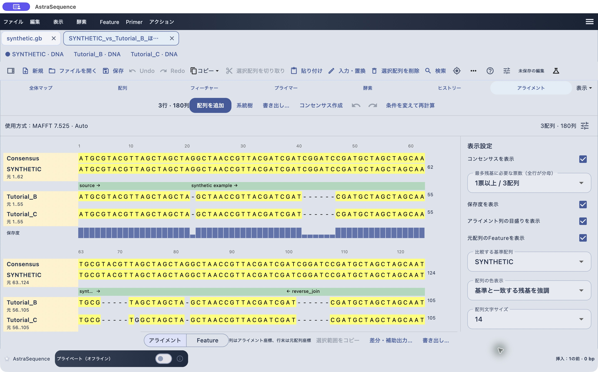

# アライメント結果を読み、保存・交換する

[目次へ](../README.md) · 対象：0.79.2 · 更新：2026-10-30

*0.79.2のmacOS実機。合成配列による操作例。*

左側の名前は各配列、横方向はアライメントの列です。上の目盛りはgapを含む列番号、行末の数値は元の配列の座標です。gapには元配列の残基座標がありません。

1. 行数と列数、使用方式を確認します。
2. 右側の「比較する基準配列」を選びます。
3. 「配列の色表示」で一致・差異などを見分けます。
4. 「コンセンサスを表示」「保存度を表示」を切り替えます。
5. 元配列にFeatureがあれば「元配列のFeatureを表示」で対応領域を確認します。
6. 必要なら文字サイズを変え、折り返したブロックをスクロールします。

保存度はその列で最多の確定残基が占める割合です。gap・曖昧残基は投票せず、分母には含まれます。コンセンサスの票数設定と合わせて確認してください。高い保存度だけで生物学的な機能やアライメントの正しさが確定するわけではありません。

「条件を変えて再計算」で方式を見直せます。配列の並べ替え・削除、コンセンサス作成、系統樹、差分出力にも専用の入口があります。列選択のコピーはビュー内の「選択範囲をコピー」を使い、通常配列ビューのコピーと区別してください。

## 完全保存は.asaln

「保存」で.asalnへ保存し、閉じて開き直して行数・方式・表示を確認します。解析条件と元入力を残すための基本ファイルです。既存.as文書を開いていた場合は保存先が.asのまま保持されます。.asalnへ変えるには「別名で保存…」で形式を指定します。

## 交換形式を選ぶ

「書き出し…」で形式を選び、名前の置換や失う情報を確認します。

| 形式 | 主な用途と制限 |
|---|---|
| .asaln | AstraSequenceで作業を再開する完全保存 |
| .dnaln / .praln | 対応するSnapGeneアライメントとの交換。未知の形式や非連続番号などは拒否される場合があります |
| .aln | Clustal形式。空白を含む名前などは別名になる場合があります |
| 複数FASTA | gapを含む各行を交換。注釈・履歴・条件は完全保存されません |
| PHYLIP | 固定幅の識別子制約により名前が変わる場合があります |
| NEXUS | 対応する単一分子種の行列を交換 |
| MSF | 配列長・分子種・チェックサムなどを検証して読み込み |
| Stockholm | 対応する注釈を含む形式。編集後に全ての元注釈が再適用されるとは限りません |

同じ長さの複数FASTAは、gapがなくてもアライメントとして表示される場合があります。既存の列を読むことと、新しくアライメント計算することを区別してください。交換形式のビュー読み込みは2〜12行、100,000列、元データ2 MBの制限があり、エンジンの計算上限とは別です。

アライメント図は「ファイル → 図を書き出す」から利用可能なSVG／PNG出力を選びます。用途に応じて画面のスクリーンショットも使えます。
