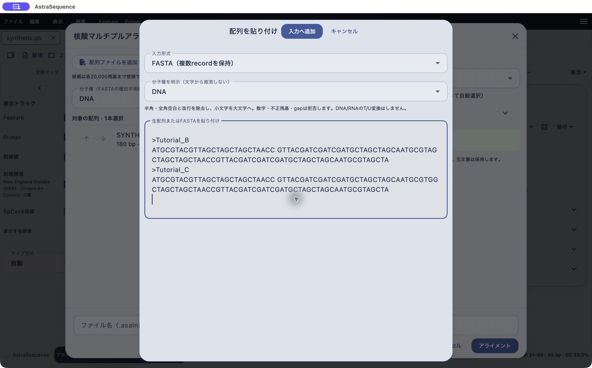
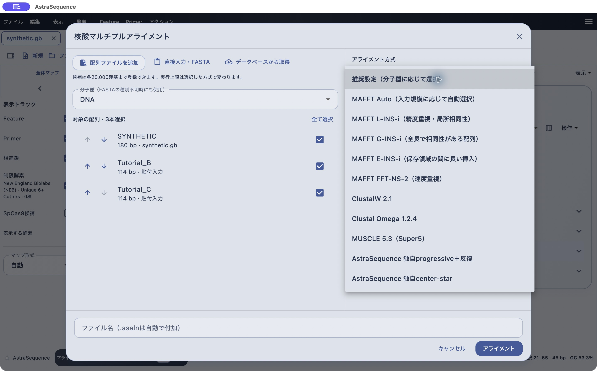

# 複数の核酸・タンパク配列をアライメントする

[目次へ](../README.md) · 対象：0.84.0 · 更新：2026-11-05

*0.79.2のmacOS実機。合成配列による操作例。*

## 入力をそろえる

1. 「アクション → 配列アライメント → 複数の核酸配列をアライメント…」を開きます。タンパクの場合は「複数のタンパク配列」を選びます。
2. 比較する配列の分子種を指定します。核酸の入口ではDNA／RNAの指定も確認します。
3. 「配列ファイルを追加」を押し、1つ目のファイルを選びます。
4. **もう一度「配列ファイルを追加」**を押して2つ目を登録します。候補一覧に名前と長さが増えたことを確認します。一括選択も、1ファイルずつの順次追加も可能です。
5. 対象のチェック状態を確認し、同じ分子種の配列を2〜12本選びます。

FASTA、GenBank、SnapGene .dnaなどから配列を追加できます。ファイル選択後に候補が増えない場合は、画面内のエラーと分子種・長さを確認してください。選択操作が完了したことと、候補への登録成功は別です。

*0.79.2のmacOS実機。合成配列による操作例。*

## 直接入力する

「直接入力・FASTA」で、生配列またはFASTAを選びます。FASTAでは各配列の前に `>配列名` を付けます。分子種を明示し、「入力へ追加」を押します。未アライメント入力にはgapを入れません。DNAとRNAのT／Uは自動変換しません。

[練習用DNA FASTA](../examples/tutorial-dna.fna)をダウンロードして追加する方法もあります。内蔵合成サンプルを開いた状態でこの2配列を追加すると、画像の3本の設定を再現できます。これは操作練習用データです。

## データベースから追加する

「データベースから取得」からNCBI、UniProt、PDBj、Ensemblのいずれかを選び、公開IDを入力します。取得内容をプレビューし、必要な配列を候補へ追加します。遺伝子名だけで意図したアイソフォーム・株・鎖が一致するとは限らないため、IDと由来を記録してください。公開IDの取得と、BLASTへの手持ち配列の送信は異なる操作です。

*0.79.2のmacOS実機。合成配列による操作例。*

## アルゴリズムを選ぶ

「推奨設定」の実効方式は核酸がMAFFT Auto、タンパクがMAFFT L-INS-iです。どのデータでも唯一最適という意味ではありません。目的や配列長に応じて選び、結果のgapと保存領域を確認してください。

| 選択肢 | 画面での用途・注意 |
|---|---|
| MAFFT Auto | 入力規模に応じて方式を自動選択 |
| MAFFT L-INS-i | 局所相同性を考慮する精度重視の設定 |
| MAFFT G-INS-i | 全長で相同性がある配列向け |
| MAFFT E-INS-i | 保存領域の間に長い挿入がある配列向け |
| MAFFT FFT-NS-2 | 速度重視の設定 |
| ClustalW 2.1 | 明示的にClustalWを実行 |
| Clustal Omega 1.2.4 | 明示的にClustal Omegaを実行 |
| MUSCLE 5.3 | Super5方式を実行 |
| AstraSequence独自方式 | progressive＋反復／center-star。上記エンジンと同じ計算ではありません |

## 長い配列を扱うときの上限

| 処理 | 上限 |
|---|---|
| 候補への登録 | 各20,000残基。1回の追加は12配列・合計60,000残基、候補一覧は最大50配列 |
| 核酸MAFFT Auto／FFT-NS-2 | 各20,000、選択分の合計60,000残基、2〜12本 |
| タンパク・その他のMSA方式 | 各2,000、合計10,000残基、2〜12本 |
| 2配列アライメント | 各5,000残基、計算量400万セルの制限も適用 |
| 外部エンジン実行 | 60秒上限 |

長い.dnaファイルが候補に入っても、選択した方式では実行できない場合があります。長い核酸はAuto／FFT-NS-2へ切り替えてください。方式を変えても候補は保持されます。上限内でも計算が時間切れになる場合があります。

## 実行して結果へ進む

「アライメント」を押します。処理中は取り消せます。成功すると設定画面が閉じ、新しいアライメント文書が開きます。元の文書は保持されます。向きの逆相補や環状配列の原点回転は自動探索しないため、比較前にそろえてください。

2配列だけを局所的に比較したい場合は、同じメニューの「2つの核酸／タンパク配列」を使います。全長・局所・半全長の方式とスコア設定を確認して実行します。

次は[結果の読み方と保存](alignment-viewer.md)へ進みます。

## タンパク配列で練習する

[合成タンパクFASTA](../examples/tutorial-protein.faa)を「複数のタンパク配列をアライメント…」で追加し、Protein_A・B・Cの3本だけを選択します。分子種がタンパク、推奨設定の実効方式がMAFFT L-INS-iになっていることを確認して実行します。結果ではアミノ酸置換とgapを見比べ、.asalnで保存してください。この練習入力の実機計算は今回の画像撮影には含めていません。
