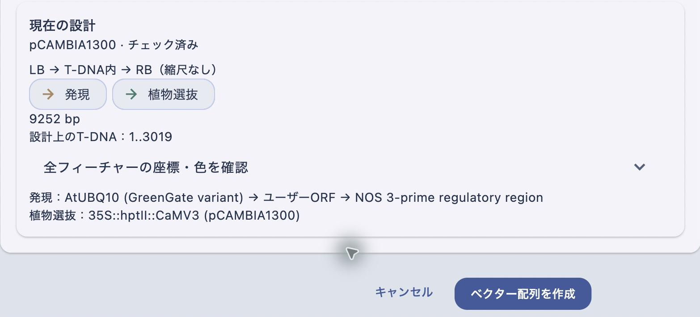
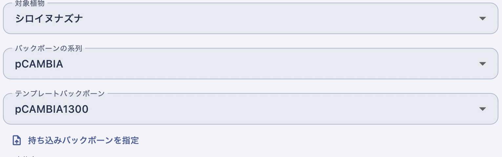
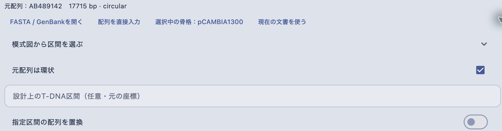
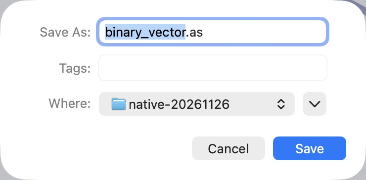

# バイナリーベクターを設計する

[目次へ](../README.md) · 対象：0.92.1 · 更新：2026-11-26

「アクション」→「バイナリーベクター構築…」を開くと、宿主は「植物」、設計の始め方は「各配列を指定して新規作成」です。目的に応じて次の入口を選びます。

**図1　上部の「アクション」を開き、先頭の「バイナリーベクター構築…」を選びます。**

| やりたいこと | 入口 |
|---|---|
| 部品を選んで植物用の文書を作る | 「各配列を指定して新規作成」 |
| 収録済みベクターの配置を出発点にする | 「プリセットから新規作成」。模式図で要素の並びと向きを確認 |
| 既存の配列の一部を書き換える | 「各配列を指定して新規作成」→「1. 目的・系列・バックボーン」→「選んだ区間を置換」 |
| 酵母用の設計を記録する | ウィンドウ右上の「植物 ▾」→「酵母」 |

**図2　最上段右に宿主の「植物」、タブの下に「設計の始め方」があります。既存配列の編集は左下の「選んだ区間を置換」から開きます。**

**図3　プリセットを選ぶと、その下の「現在の構成」に模式図が出ます。色枠は各要素、矢印は転写方向、数字は出力配列上の座標です。**

## 植物の標準設計

**手順1**　初期設定を使う場合は「2. 発現カセット」の「ORF（ユーザーが直接入力）」に入力します。

**図4　発現カセットを下へスクロールし、「ORF（ユーザーが直接入力）」の大きな枠をクリックします。**

**手順2**　「7. 設計チェックと作成」で「配列をチェック」を押します。未完了の項目があれば「該当項目へ」から修正し、もう一度チェックします。

**図5　青い「配列をチェック」を押します。成功すると直下に「設計チェック完了」と表示されます。**

**手順3**　「ベクター配列を作成」を押します。結果が新しい文書で開きます。

**図6　「現在の設計」で全長とT-DNA区間を確認し、右下の「ベクター配列を作成」を押します。**

構成を変更するときは、各セクションでバックボーン、プロモーター、選抜マーカーなどを選びます。手元の配列は「持ち込みバックボーンを指定」または各部品の「配列入力／FASTA・GenBankから指定」から読み込めます。「カセットの配置・接合部」ではカセットの追加・並べ替えや非コードRNAの指定ができます。変更後は再度チェックし、模式図の配置と設計上のT-DNA区間を確認してください。

**図7　対象植物、系列、テンプレートを上から選びます。手元の骨格を使う場合の入口はその下にあります。**

## 植物と酵母を切り替える

「酵母」を選ぶと、酵母の種・株、維持形式、選択マーカー、文献・参照資料の入力欄が開きます。同じウィンドウ内で宿主を切り替えると、それぞれの入力が保持されます。区間編集画面では、宿主での選抜・維持や接合条件は「未評価」と表示されます。「全長参照を選択」で確認できるのは、指定した参照との配列一致です。

**図8　酵母に切り替えた画面。上から種・株、維持形式、選択マーカーです。図は宿主を往復した後の入力例です。**

## 区間置換と座標の読み方

元配列を選び、必要に応じて「設計上のT-DNA区間」に**置換前**の座標を入力します。「指定区間の配列を置換」をオンにし、開始・終了と置換配列を指定します。座標は先頭を1とし、両端を含みます。逆鎖の向きで入力した場合は「入力する配列は逆鎖の向き」を選びます。

**図9　元配列と長さを確認し、T-DNA区間を入力して「指定区間の配列を置換」をオンにします。**

**図10　開始と終了は元配列の座標です。逆鎖の指定と置換配列の欄はその下にあります。**

「設計チェック」で置換前後の座標を比較します。置換境界が注釈の一部を横切って作成できない場合は、表示された注釈と指定範囲を見直してください。作成後は「フィーチャー」で座標と向き、「全体マップ」で要素ごとの色を確認できます。

たとえば、検証用文書で 4271..4522 の252塩基を4塩基に置換すると、置換後の範囲は 4271..4274 です。下流の開始位置は248塩基手前に移り、T-DNA区間は 4151..13196 から 4151..12948 に更新されました。

**図11　チェック結果は「元の座標 → 設計後」の順です。promoter は「置換」、下流の nptII は座標が移っても「保持」と表示されます。**

**図12　再読込後の全体マップ。中央に全長、円周の内側に色分けされたフィーチャーと Designed T-DNA が表示されます。**

## 設計途中と完成後の保存

区間編集を後で続ける場合は「設計下書きを保存」でJSONを保存し、「設計下書きを開く」またはタイトル横のフォルダから再開します。完成した配列・座標・色を残すには、作成した文書を .as で保存します。Macでは全体マップから ⌘⇧S で「別名で保存」を開けます。[保存と書き出し](saving.md)

**図13　設計を続けるときに使う「設計下書きを保存」と「設計下書きを開く」は区間編集画面にあります。**

**図14　完成文書の別名保存。ファイル名の末尾が .as であることと保存先を確認し、「Save」を押します。**

撮影環境はmacOSです。図9〜11・13は0.92.0の区間編集画面、その他は0.92.1の実画面です。操作箇所を読み取れるよう、各図は必要な範囲を切り出しています。
