# バイナリーベクターを設計する

[マニュアル目次](../README.md) · AstraSequence 0.92.1

[クイックスタート](#クイックスタート) ｜ [植物の設計オプション](#植物の設計オプション) ｜ [手元の配列を使う](#手元の配列を使う) ｜ [プリセットから新規作成](#プリセットから新規作成) ｜ [既存配列の区間を置換する](#既存配列の区間を置換する) ｜ [酵母用の設計配列を作る](#酵母用の設計配列を作る) ｜ [保存して作業を再開する](#保存して作業を再開する)

## クイックスタート

植物用の設計配列を、内蔵バックボーンとプロモーターを使って作る例です。

「アクション」→「バイナリーベクター構築…」を開きます。

---

右上の宿主が「植物」、「設計の始め方」が「各配列を指定して新規作成」であることを確認します。

---

「1. 目的・系列・バックボーン」で「対象植物」→「バックボーンの系列」→「テンプレートバックボーン」の順に確認します。画面例は「シロイヌナズナ」→「pCAMBIA」→「pCAMBIA1300」です。系列を変えた場合は、最後の欄で使用するベクター名を確認します。

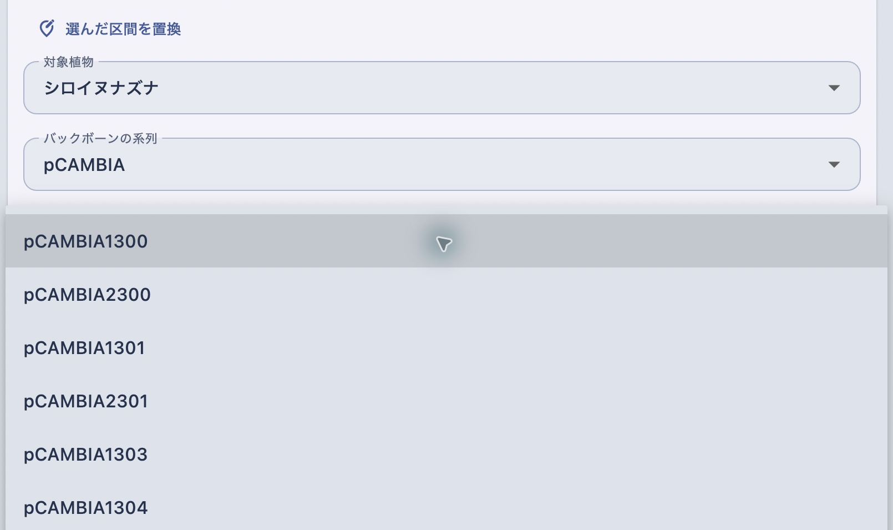

---

「2. 発現カセット」を開き、「プロモーター／leader・連結イントロン」を押します。候補には変種名と長さが表示されます。この例では「AtUBQ10 (GreenGate variant)」（633 bp）を使います。

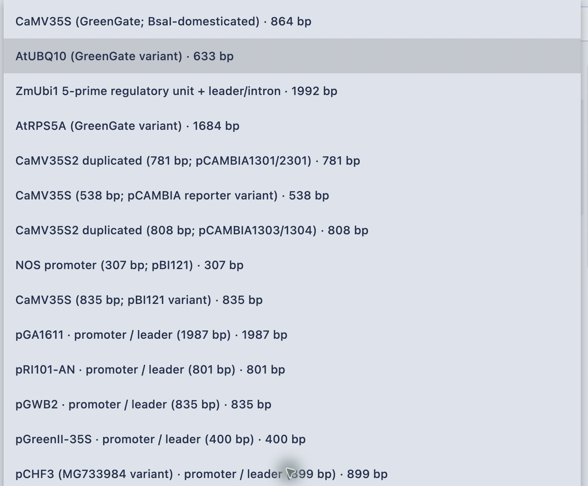

---

同じセクションの「ORF（ユーザーが直接入力）」に目的のコード配列を入力し、その下でターミネーターとカセットの向きを確認します。

---

「7. 設計チェックと作成」で「配列をチェック」を押します。「未完了」が出たら「該当項目へ」で戻って入力を修正します。「設計チェック完了」が表示されたら、全長と「設計上のT-DNA」を確認します。

---

「ベクター配列を作成」を押します。この例では全体マップの中央に「9252 bp」と表示されます。「ファイル」→「保存」で設計配列を保存します。

## 植物の設計オプション

変更した項目は最後に「配列をチェック」で確認します。

「1. 目的・系列・バックボーン」では、対象植物、系列、テンプレートの順に選びます。「バックボーンの出典・利用条件」で参照を確認できます。「産物名」は作成する設計配列の名前です。

---

「2. 発現カセット」では、プロモーター、ORF、ターミネーターを個別に指定します。「カセットの向き」は出力配列に対する向きです。イントロンとORF両端の接合部は同名の折りたたみ項目にあります。「ターミネーター・3′制御領域」を開くと候補が表示されます。

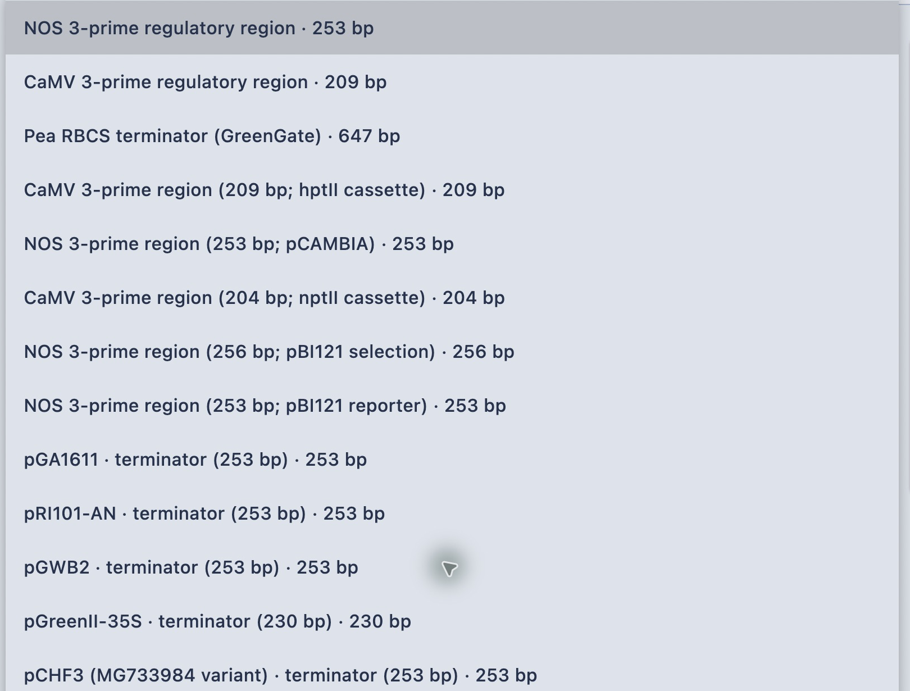

---

「3. 植物の選抜マーカー」で選べる内蔵の完全カセットには、調節領域も含まれます。持ち込み時は、入力が完全カセットかマーカーCDSかを指定します。後者では調節領域も選びます。

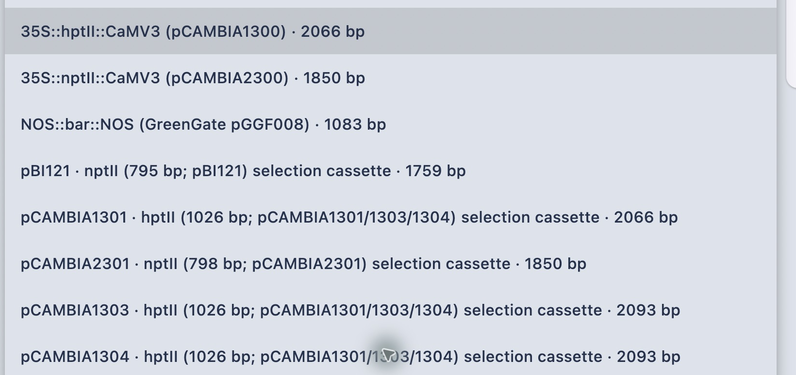

---

「4. 組換え体レポーター」では、「独立したレポーターカセットを追加する」をオンにすると、そのカセット用の入力欄が開きます。

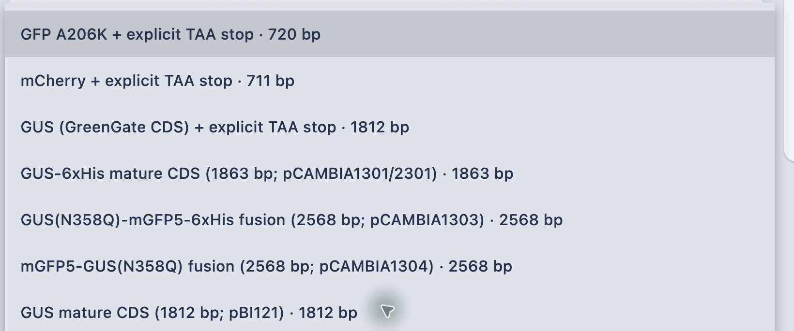

---

「5. カセットの配置・接合部」では、「カセットを追加」で種類を選びます。非コードRNAでは転写領域を指定します。「前へ」「後へ」は最初のborderから見た並び順を変えます。向きは各カセット側で指定します。

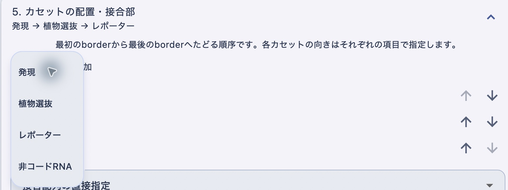

---

同じセクションの「接合チェック方式」で、組立に使う方式を選びます。Gibson、In-Fusion、Golden Gateなど選択した方式に応じ、入力した境界情報が検査されます。並べ替えた後は隣り合う部品が変わるため再チェックします。

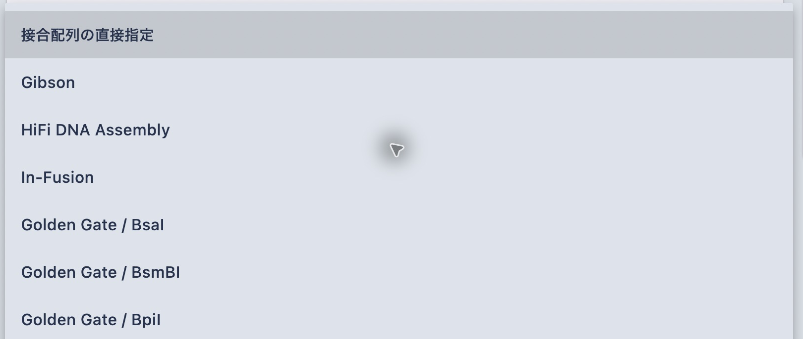

---

「6. 使用菌株・helper・細菌選択」では、菌株とhelperを手元の記録に合わせて選びます。表示項目は系列と構築段階で変わります。選択薬や追加耐性に関する指摘はこのセクションで確認します。

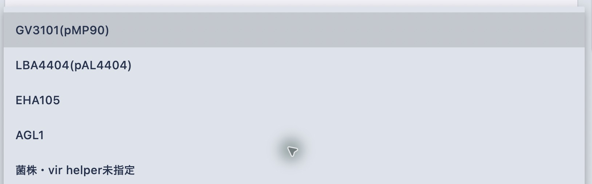

---

「7. 設計チェックと作成」では、「酵素認識部位の追加検査」で対象を選んでからチェックします。結果の「全フィーチャーの座標・色を確認」を開くと、作成前に出力上の注釈を確認できます。

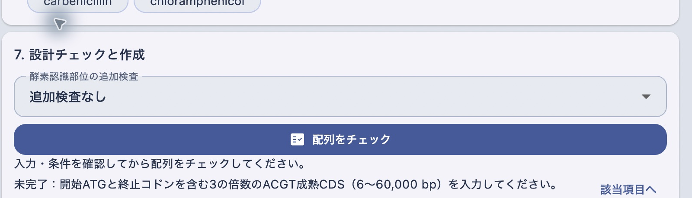

---

系列によって変更できる範囲が異なります。Gateway LRの画面で「元のdestinationの配置を保持」と表示される項目は、元の構成を引き継ぎます。

## 手元の配列を使う

バックボーン全体は「持ち込みバックボーンを指定」、一つの部品はその部品欄の「配列入力／FASTA・GenBankから指定」を開きます。

ファイルを選ぶか、配列を貼り付けて「貼り付けを取り込む」を押します。複数レコードがあるときは「取り込むレコード」で名前と長さを確認します。

---

**部品**の場合は「部品として抽出する注釈」で全長・注釈・座標指定から選びます。**バックボーン**の場合は元配列のRB・LB、T-DNA区間、維持・選択条件を確認します。

部品名またはバックボーン名を確認して設計に戻り、配列チェックを実行します。内蔵部品の由来を調べるには「内蔵ライブラリ・出典」タブを開きます。

## プリセットから新規作成

「設計の始め方」で「プリセットから新規作成」を選びます。「プリセット」の欄を開き、使いたいベクター名を選びます。

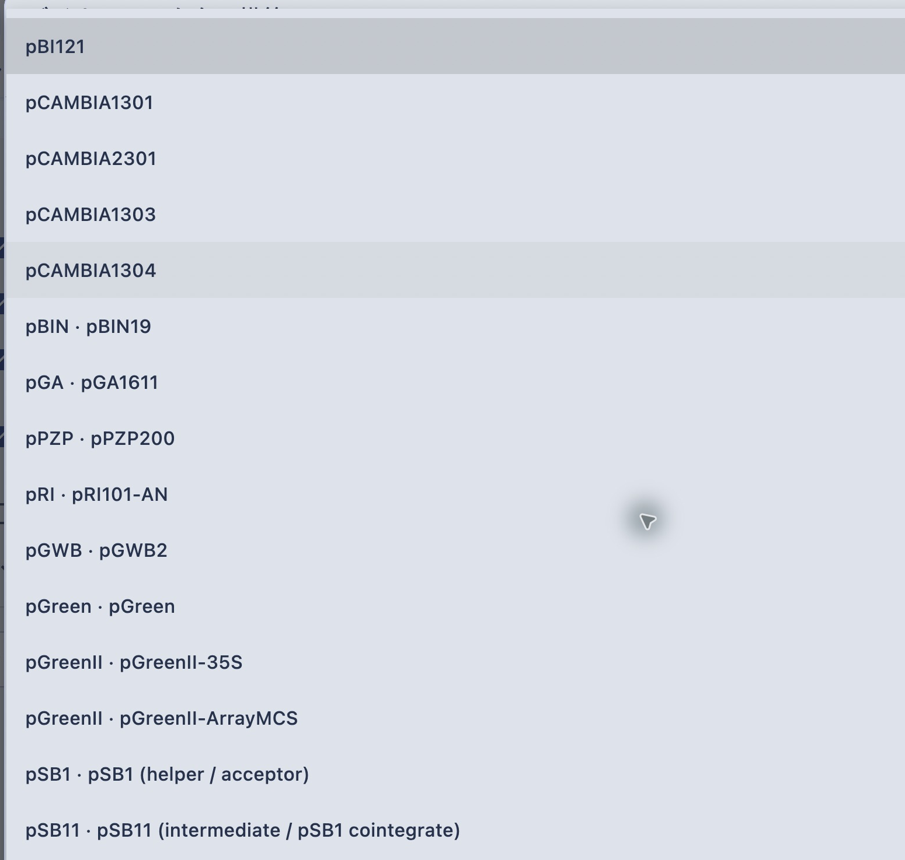

---

「現在の構成」で選んだ名前と全長を確認します。以下はpBI121を選んだ例です。模式図の矢印は転写方向、数字は出力配列上の座標です。スクロールするとborder、各カセット、接合部を順に確認できます。

---

公開配列と全長を照合する場合は、「出力の原点」で「公開参照と同じ原点」を選びます。部品を差し替える場合は対象のカセットを開き、プロモーター変種や成熟CDSを指定します。

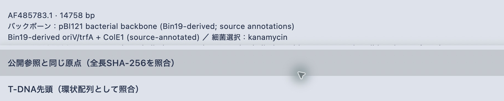

---

チェックを実行し、全長参照との照合結果を読みます。公開配列から変更した場合は、意図した変更と表示された構成を確認してから「ベクター配列を作成」を押します。

## 既存配列の区間を置換する

「選んだ区間を置換」を開き、元配列を指定します。今開いている設計配列を使うには、元配列の選択欄で「選択中の骨格」の右隣のボタンを押します。選択中の骨格、ローカルのFASTA／GenBank、直接入力も使えます。画面に出たレコード名と全長を確認します。

---

T-DNA区間の変化を追う場合は「設計上のT-DNA区間」に元配列の座標を入力します。「指定区間の配列を置換」をオンにし、開始・終了と置換配列を入力します。開始は1始まり、終了はその塩基を含みます。入力配列を逆鎖の向きで用意した場合は「入力する配列は逆鎖の向き」を選びます。

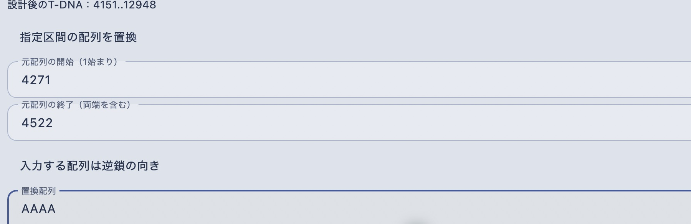

---

「設計チェック」を押し、各行を **元配列の座標 → 設計後の座標** の順に読みます。「保持」は注釈が残るという意味で、位置は移る場合があります。置換境界が注釈を部分的に横切って作成が止まったら、指摘された注釈と入力範囲を見直します。この例では、元の 4271..4522 の252塩基を4塩基に置換しています。置換部分は 4271..4274 になり、下流の注釈は 4535..5329 から 4287..5081 へ248塩基移ります。同じ設計配列のT-DNA区間は 4151..13196 から 4151..12948 になります。

---

全長の比較対象がある場合は「全長参照を選択」で指定します。結果を確認して「ベクター配列を作成」を押します。設計配列では「フィーチャー」で座標と向き、「全体マップ」で色と配置を確認できます。

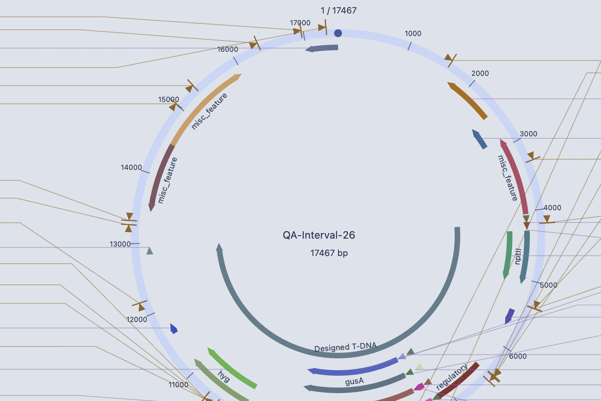

## 酵母用の設計配列を作る

「各配列を指定して新規作成」を開き、右上の「植物 ▾」で「酵母」を選びます。

「酵母の種・株」を入力し、「酵母での維持形式」を開きます。「未指定」「自律複製プラスミド」「染色体組込み」「酵母人工染色体（YAC）」から元資料に対応する項目を選びます。

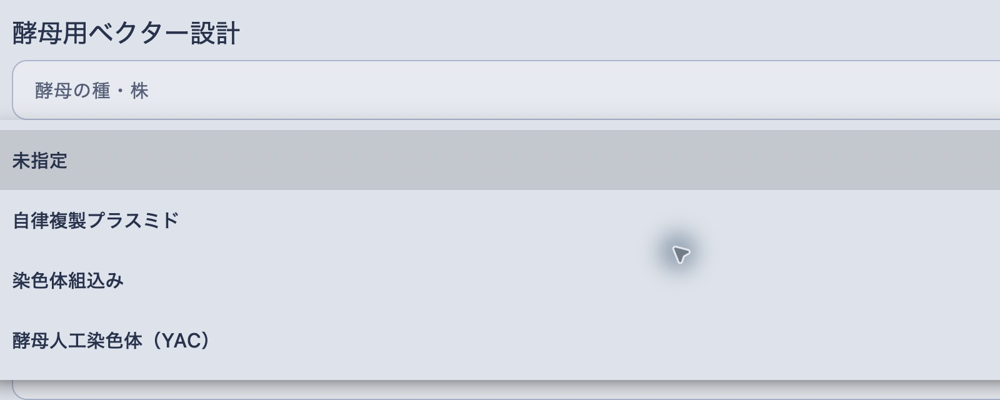

---

「酵母での選抜マーカー」を入力します。「文献・参照資料」には設定の根拠を記録できます。以下は「染色体組込み」を選んだ入力例です。

---

元配列を指定し、必要なら区間を置換して「設計チェック」を押します。「未評価」と表示される選抜・維持・接合条件は元資料で確認してください。

同じウィンドウで宿主を切り替えると、植物・酵母それぞれの入力が復元されます。

## 保存して作業を再開する

区間や宿主の設定を引き続き調整する場合は、区間編集画面の「設計下書きを保存」でJSONを保存します。再開するときは「設計下書きを開く」か、設計ウィンドウ右上のフォルダを選びます。

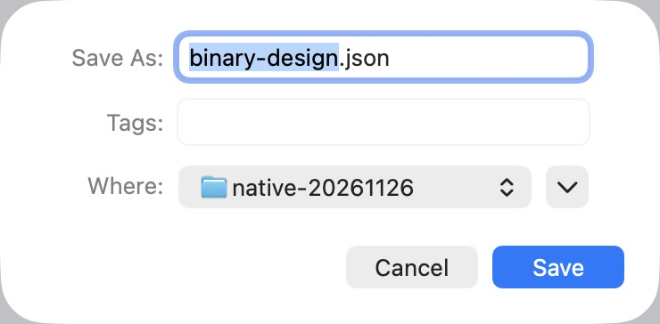

---

作成した設計配列を注釈や色とともに残すには、「ファイル」から「保存」または「別名で保存…」を選び、.as形式で保存します。「ファイルを開く」から再度開けます。

---

他のソフトに渡す場合は、「別名で書き出す…」で形式を選びます。[形式別の保存内容](saving.md)

掲載した画面はすべてmacOS版AstraSequence 0.92.1の検証用アプリで撮影しました。
