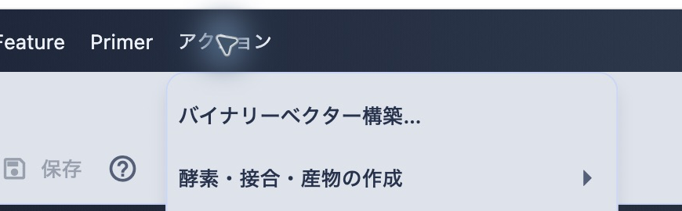
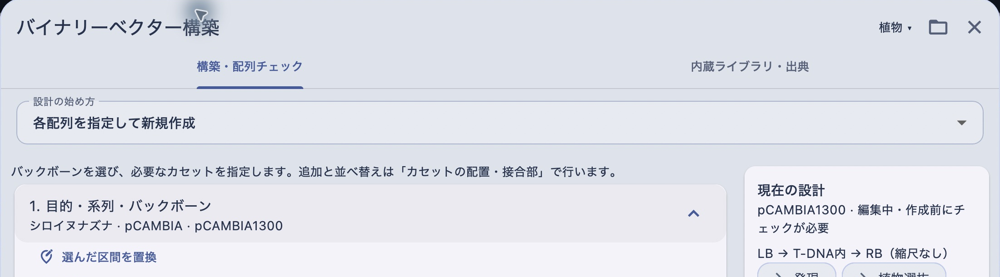
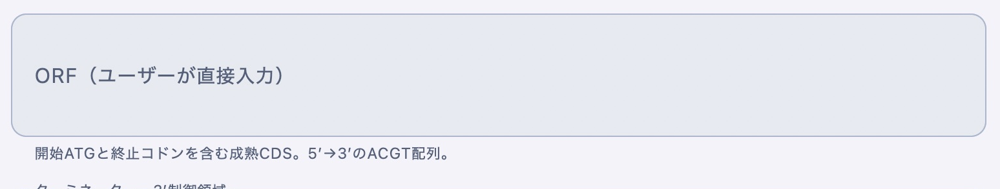
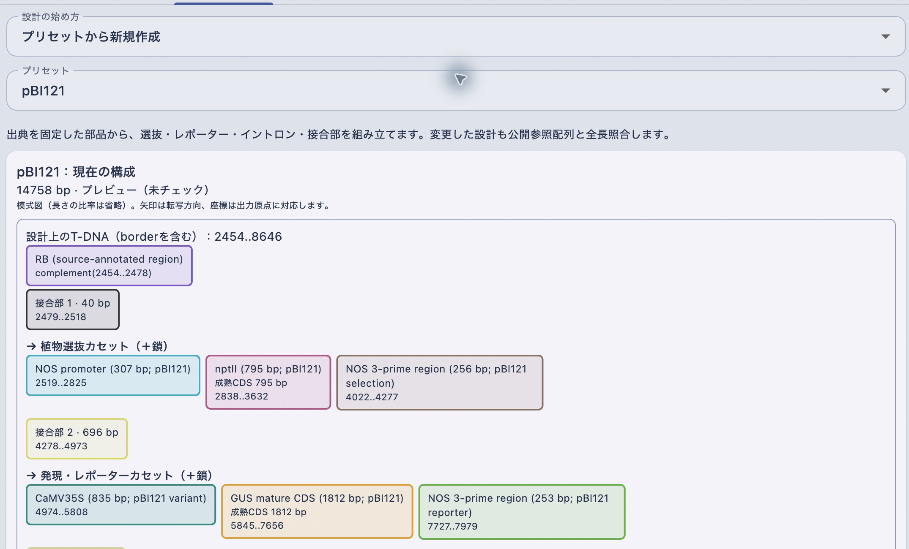
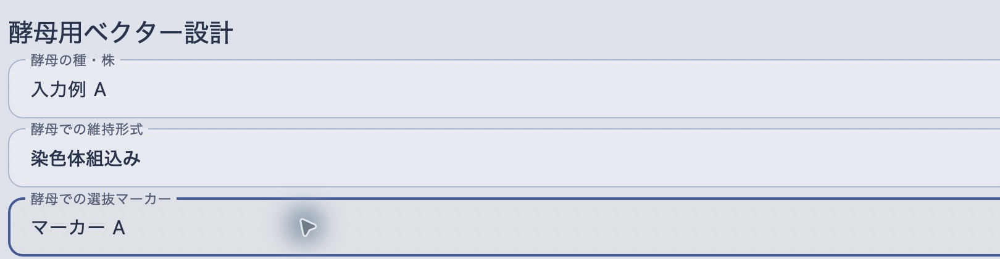
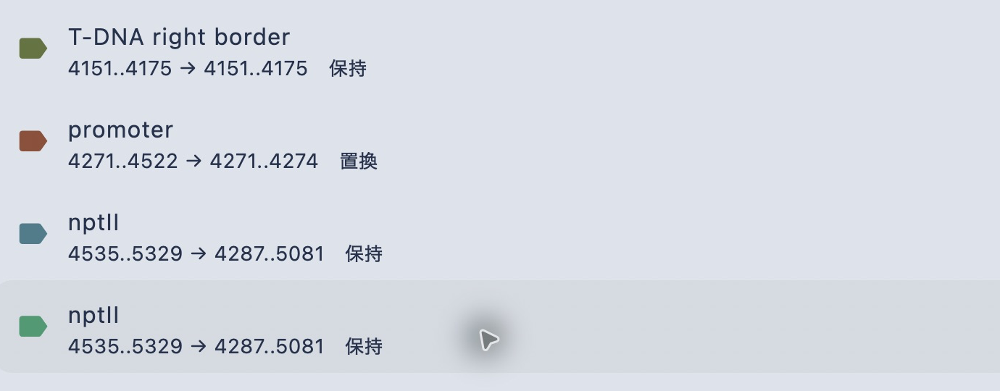

# バイナリーベクターを設計する

[マニュアル目次](../README.md) · AstraSequence 0.92.1

## まず植物用の文書を一つ作る

**「アクション」→「バイナリーベクター構築…」** を開きます。初期画面では、右上の宿主が「植物」、上部の「設計の始め方」が「各配列を指定して新規作成」です。初期設定を使う場合、開いた後の必須操作は次の3つです。

1. **ORFを入力する。** 「2. 発現カセット」を開き、「ORF（ユーザーが直接入力）」欄に目的の配列を入力します。
2. **チェックする。** 下にスクロールして「7. 設計チェックと作成」の「配列をチェック」を押します。「設計チェック完了」が目印です。「未完了」が出たら「該当項目へ」で入力欄に戻り、修正後にもう一度チェックします。
3. **文書を作る。** 「現在の設計」で全長と「設計上のT-DNA」を確認し、ウィンドウ下部の「ベクター配列を作成」を押します。新しい文書が開きます。

文書を残すには「ファイル」→「保存」を選びます。元の設計や文書を手元に残して別の名前で保存したい場合は「別名で保存…」を選びます。Macでは全体マップからも ⌘⇧S を使えます。

[標準設計の画面を見る](#標準設計の画面) · [設定を変更する](#植物の設計オプション)

[プリセット・バックボーン・酵母の画面を見る](#設計オプションの画面) · [区間編集・保存の画面を見る](#区間編集と保存の画面)

## どの設計画面を使うか

| 出発点 | 開き方 | 編集できる内容 |
|---|---|---|
| 手元の部品、または内蔵ライブラリ | 植物の初期画面「各配列を指定して新規作成」 | バックボーンと各カセットを個別に指定。プロモーターだけの持ち込みも可能です。 |
| 名前が分かっている収録ベクター | 「設計の始め方」→「プリセットから新規作成」 | 「プリセット」で選ぶと「現在の構成」に要素と接合部が並びます。色枠は要素、矢印は転写方向、数字は出力配列上の座標です。変更したら再チェックして全長照合の結果を読みます。 |
| すでにある配列の一部 | 植物の「1. 目的・系列・バックボーン」→「選んだ区間を置換」 | 元文書上の開始・終了を指定し、変更の影響を注釈ごとに比較します。 |
| 酵母用の文書 | 「各配列を指定して新規作成」の右上「植物 ▾」→「酵母」 | 元配列に酵母の設定を記録し、必要に応じて区間を編集します。 |

## 植物の設計オプション

標準設計から変えたい行だけを開いてください。編集後は「7. 設計チェックと作成」で結果を更新します。

| 変えたいもの | 開くセクション | 選択の意味・確認箇所 |
|---|---|---|
| 対象植物・バックボーン | 1. 目的・系列・バックボーン | 対象植物、系列、テンプレートの順に選びます。「バックボーンの出典・利用条件」で参照を確認できます。「産物名」は完成文書で使う名前です。 |
| 発現カセットの構成 | 2. 発現カセット | プロモーター、ORF、ターミネーターを個別に指定します。「カセットの向き」は出力配列に対する向きです。イントロンとORF両端の接合部は同名の折りたたみ項目にあります。 |
| 植物の選抜マーカー | 3. 植物の選抜マーカー | 内蔵の完全カセットには調節領域も含まれます。持ち込み時は、入力が完全カセットかマーカーCDSかを指定します。後者では調節領域も選びます。 |
| 独立したレポーター | 4. 組換え体レポーター | 「独立したレポーターカセットを追加する」をオンにすると、そのカセット用の入力欄が開きます。 |
| カセットの数・種類・順序 | 5. カセットの配置・接合部 | 「カセットを追加」で種類を選びます。非コードRNAでは転写領域を指定します。「前へ」「後へ」は最初のborderから見た並び順を変えます。向きは各カセット側で指定します。 |
| 接合部の検査 | 5. カセットの配置・接合部 | 「接合チェック方式」で使う方式を選びます。Gibson、In-Fusion、Golden Gateなど選択した方式に応じ、入力した境界情報が検査されます。並べ替えた後は隣り合う部品が変わるため再チェックします。 |
| 菌株・helper・細菌側の選択 | 6. 使用菌株・helper・細菌選択 | 手元の記録に合わせて選びます。表示項目は系列と構築段階で変わります。選択薬や追加耐性に関する指摘はこのセクションで確認します。 |
| 認識部位の追加検査 | 7. 設計チェックと作成 | 「酵素認識部位の追加検査」で対象を選んでからチェックします。結果の「全フィーチャーの座標・色を確認」を開くと、作成前に出力上の注釈を確認できます。 |

系列によって変更できる範囲が異なります。たとえばGateway LRの画面に「元のdestinationの配置を保持」と表示される項目は元の構成を引き継ぎます。カセット全体を自分で並べたい場合は、部品を個別指定できる構築方式を選びます。

### 手元の配列を読み込む

バックボーン全体は「持ち込みバックボーンを指定」、一つの部品はその部品欄の「配列入力／FASTA・GenBankから指定」を開きます。

1. ファイルを選ぶか、配列を貼り付けて「貼り付けを取り込む」を押します。複数レコードがあるときは「取り込むレコード」で名前と長さを確認します。
2. **部品**の場合は「部品として抽出する注釈」で全長・注釈・座標指定から選びます。**バックボーン**の場合は元配列のRB・LB、T-DNA区間、維持・選択条件を確認します。
3. 部品名またはバックボーン名を確認して設計に戻り、配列チェックを実行します。内蔵部品の由来を調べるには「内蔵ライブラリ・出典」タブを開きます。

## 既存配列の区間を置換する

1. 「選んだ区間を置換」を開き、元配列を指定します。「現在の文書を使う」、選択中の骨格、ローカルのFASTA／GenBank、直接入力から選べます。画面に出たレコード名と全長を確認します。
2. T-DNA区間の変化を追う場合は「設計上のT-DNA区間」に**元配列の座標**を入力します。「指定区間の配列を置換」をオンにし、開始・終了と置換配列を入力します。開始は1始まり、終了はその塩基を含みます。入力配列を逆鎖の向きで用意した場合は「入力する配列は逆鎖の向き」を選びます。
3. 「設計チェック」を押し、各行を **元配列の座標 → 設計後の座標** の順に読みます。「保持」は注釈が残るという意味で、位置は移る場合があります。置換境界が注釈を部分的に横切って作成が止まったら、指摘された注釈と入力範囲を見直します。
4. 全長の比較対象がある場合は「全長参照を選択」で指定します。結果を確認して「ベクター配列を作成」を押します。完成文書では「フィーチャー」で座標と向き、「全体マップ」で色と配置を確認できます。

**画面例の読み方**　図11では、元の 4271..4522 の252塩基を4塩基に置換しています。置換部分は 4271..4274 になり、下流の注釈は 4535..5329 から 4287..5081 へ248塩基移ります。同じ文書のT-DNA区間は 4151..13196 から 4151..12948 になります。

## 酵母の設定と宿主の切り替え

右上の宿主を「酵母」にすると、「酵母の種・株」「酵母での維持形式」「酵母での選抜マーカー」が表示されます。維持形式は「未指定」「自律複製プラスミド」「染色体組込み」「酵母人工染色体（YAC）」から、元資料に対応する項目を選びます。「文献・参照資料」には判断の根拠を記録できます。

同じウィンドウで「植物」に戻すと植物側の入力が復元され、再び「酵母」を選ぶと酵母側の設定が復元されます。区間編集画面の「未評価」は、宿主での選抜・維持や接合条件の適否をアプリが判定していないことを示します。「全長参照」は指定した配列との照合結果です。

## 保存して作業を再開する

| 次にしたいこと | 保存時 | 再開時 |
|---|---|---|
| 区間・宿主・置換入力を引き続き調整する | 区間編集画面の「設計下書きを保存」でJSONを保存 | 「設計下書きを開く」または設計ウィンドウ右上のフォルダから読み込む |
| 完成文書の配列・注釈・色を開き直す | 作成後、文書側の「保存」または「別名で保存…」で .as を保存 | 「ファイルを開く」で .as を選ぶ |
| 他のソフトに渡す | 「別名で書き出す…」で形式を選択 | 対応するソフトで開く。[形式別の保存内容](saving.md) |

## 標準設計の画面

**図1　構築メニューの位置**

**図2　宿主と設計の始め方**

**図3　ORF入力欄**

**図4　チェック完了の表示**

**図5　全長・T-DNA区間と作成ボタン**

## 設計オプションの画面

**図6　バックボーンの選択と持ち込み**

**図7　プリセットの構成と転写方向**

**図8　酵母の株・維持形式・選抜マーカー**

## 区間編集と保存の画面

**図9　元配列とT-DNA区間**

**図10　置換範囲と向き**

**図11　置換前後の座標**

**図12　再読込後の円形マップ**

**図13　区間編集の下書き保存**

**図14　完成文書の別名保存**

撮影環境はmacOSです。図9〜11・13は0.92.0、その他は0.92.1の実画面です。
