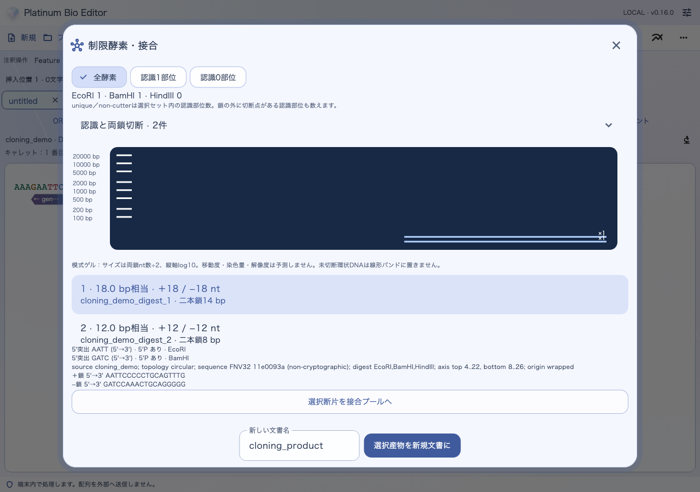

# 消化・接合・クローニングの産物を作る

[目次へ](../README.md) · 対象：0.79.2 · 更新：2026-10-30

酵素の表示設定は「酵素」、産物を作る操作は「アクション → 酵素・接合・産物の作成」にあります。

## 消化した断片を確認する

1. 鋳型文書を選び、「制限酵素・消化…」を開きます。
2. 使用酵素を指定し、切断位置と断片長を確認します。
3. 平滑末端／突出末端、5′／3′側、断片の向きを確認します。
4. 必要な断片を次の接合操作へ渡すか、新しい文書として作成します。

## ベクターと挿入断片を接合する

「接合プール・ライゲーション…」で対象断片と末端を確認します。Gibson／HiFi／In-Fusion、Golden Gate、Gatewayはそれぞれの専用入口を使います。条件を変えた場合は再計算してください。生成物の向き、接合境界、全長、注釈を見てから保存します。

TAクローニングは「TA／GC／TOPOの末端モデル…」で末端状態を確認します。配列を連結しただけでは試薬固有の反応条件を再現したことにはなりません。使うベクターの実配列と末端を用意してください。

生成した産物は新しい未保存文書です。元の鋳型と区別できる名前を付け、.asで保存します。図が必要なら「ファイル → 図を書き出す」からSVG／PNG／PDFを選びます。

[Primer・PCR](primers.md)からPCR産物を準備し、接合後に[Feature](features.md)と[制限酵素](enzymes.md)を確認すると、一連の作業を追いやすくなります。

*旧レイアウトの自動UIテストによる合成データの参考画像です。実機撮影ではありません。上部メニューは現行版と異なります。操作の入口は本文に記載した現行メニューを使ってください。*
