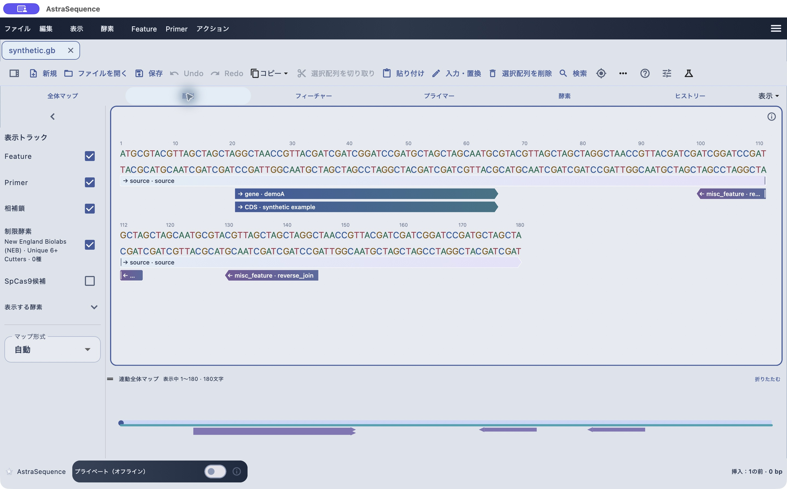
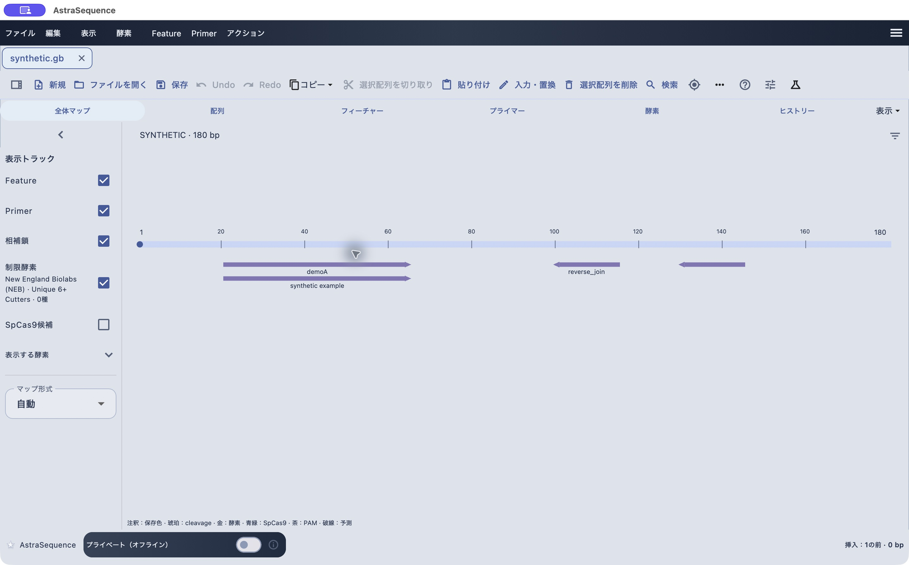

# 選択・検索・編集と表示位置の調整

[目次へ](../README.md) · 対象：0.84.0 · 更新：2026-11-06

*0.79.2のmacOS実機。合成配列による操作例。*

## 範囲を選ぶ

配列上をドラッグするか、「編集 → 選択・移動」から範囲指定・全選択を使います。特定の座標へ移動するときはGo toを使います。長い配列はドラッグ中に表示領域の上下端へポインターを移動して選択を延ばします。選択解除はEscです。

全体マップ上のドラッグでも範囲を選べます。下部の表示は開始・終了を含む座標、長さ、GC値です。末端付近へ正確に移動するときは、長距離のドラッグより「Go to · 位置へ移動…」「Select Range · 範囲を選択…」が便利です。

20万残基を超える配列を含む文書は閲覧専用です。以下の置換・削除・大小文字や色の変更は、編集可能な文書で行ってください。

「入力・置換」で選択範囲を置換し、選択がなければ挿入位置へ追加します。削除前には選択長を確認してください。Undo／Redoはツールバーまたは編集メニューにあります。編集後は注釈位置と制限酵素の再検索結果も確認します。

「編集 → 大小文字・色」から大文字・小文字にできます。選択があればその範囲、未選択なら全体が対象です。配列範囲への色付けもここで行います。

## 目的に合わせて検索する

「編集 → 検索」には核酸、コドン、酵素、Feature、Primer、類似配列の入口があります。塩基列を探す場合は配列検索、注釈名を探す場合はFeature／Primer検索を使います。検索条件の鎖・曖昧塩基・ミスマッチ設定を確認し、結果から位置へ移動します。

## 表示を広げる

左側の表示トラックでFeature・Primer・相補鎖・制限酵素を切り替えます。下の連動全体マップとの境界は上下にドラッグできます。折り畳んだ場合は「簡易マップを展開」または表示メニューのミニ全体マップ設定から戻せます。文字サイズも表示メニューで調整します。

「表示 → 配列の向き・原点」のFlip / Reverse Complement、Set Originは文書の配列・座標に関わる操作です。適用前の確認を読み、必要なら別名保存してから実行してください。単に逆相補文字列が欲しいときはコピーの逆相補を使います。

*全体マップは配列全体と注釈の位置関係を確認する模式図です。0.79.2のmacOS実機。*

## 開き直した後に選択位置を見つける

保存した選択範囲は開き直しても保持されます。ただし大きな配列では、画面内のスクロール位置が保存前と同じにならない場合があります。画面下部の選択座標を確認し、Go to／Select Rangeや検索で対象位置を表示してください。
