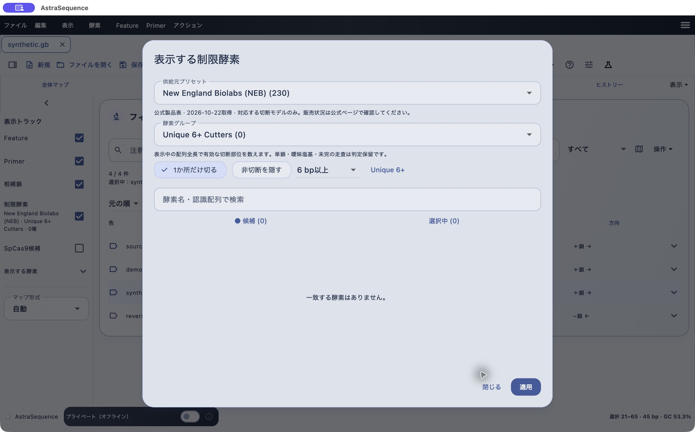

# 供給元と酵素グループで切断部位を表示する

[目次へ](../README.md) · 対象：0.84.0 · 更新：2026-11-05

*0.79.2のmacOS実機。合成配列による操作例。*

初期表示はNEBのUnique 6+ Cuttersです。表示中の配列全長で1か所切断し、認識配列が6 bp以上の酵素を対象にします。画像の合成配列では該当酵素が0件です。

1. 「酵素 → 表示する酵素・供給元プリセット…」を開きます。
2. NEB、TaKaRaなどの供給元を選びます。
3. 酵素グループを選びます。
4. 名前検索や切断数条件で絞り込み、候補と選択中の一覧を確認します。
5. 「適用」を押し、マップ・配列ビューへ戻ります。

| グループ | 選び方 |
|---|---|
| Unique Cutters | 配列を1か所で切る |
| Unique & Dual Cutters | 1または2か所で切る |
| 6+ Cutters | 認識配列が6 bp以上 |
| Unique 6+ Cutters | 1か所切断かつ6 bp以上 |
| Type IIS Enzymes | 認識部位の外側を切る対象酵素 |
| Golden Gate Enzymes | Golden Gate用の登録セット |

検索中は「検索中…」と表示されます。完了後の0件とは区別してください。酵素名にマウスを重ねると認識範囲や切断面を確認できます。シングルクリックで選択、ダブルクリックで詳細を開きます。酵素情報には供給元や製品情報への入口があります。販売状況やバッファーの情報は、収録時点とメーカーの現行情報を区別してください。

酵素間をドラッグすると、切断末端を含む選択と長さを確認できます。切断境界と認識配列の先頭座標は同じとは限りません。消化産物の作成は[アクション側の操作](cloning.md)です。

切断数の解析上限は20万残基です。これを超える配列の「判定保留」は、切断部位がないという結果ではありません。表示上限との違いは[大きな配列の操作](large-sequences.md)を参照してください。
