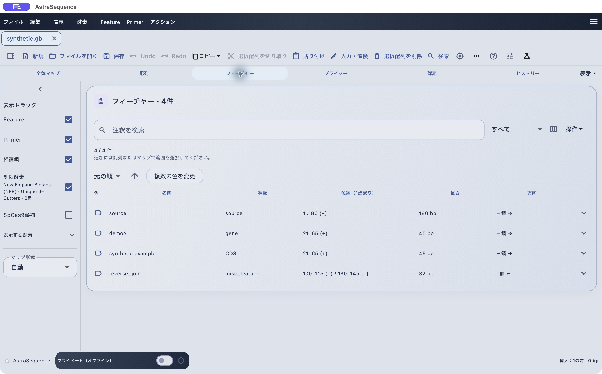
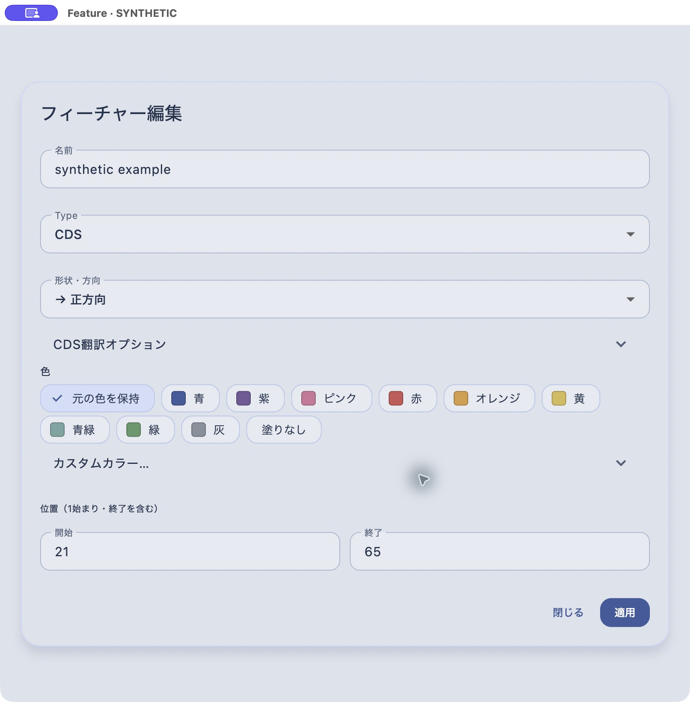
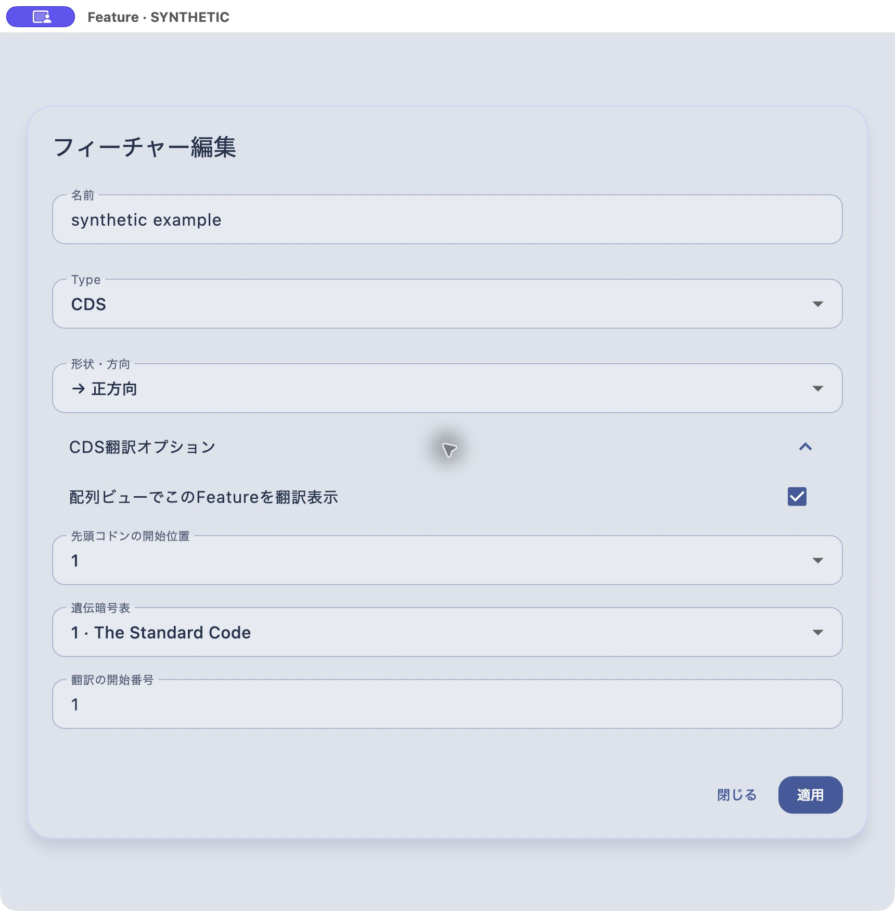

# Featureの追加、形状、セグメント、CDS翻訳

[目次へ](../README.md) · 対象：0.84.0 · 更新：2026-11-05

*0.79.2のmacOS実機。合成配列による操作例。*

配列上の領域に名前・種類・向きを付けた注釈をFeatureと呼びます。一覧では名前、種類、位置、長さ、方向を確認できます。

1. 配列またはマップで対象範囲を選択します。
2. 「Feature → Feature追加」を選びます。
3. 名前、Type、開始・終了、形状・方向を確認します。
4. 色を選びます。Featureにはカスタムカラーを指定できます。
5. 「適用」で文書へ反映します。適用後に編集窓が閉じます。
6. 文書を保存します。

既存Featureはマップ・配列ビューでシングルクリックすると選択、ダブルクリックすると詳細・編集へ進みます。メニューの「選択中の注釈を編集…」も利用できます。マウスオーバーでは対象範囲が強調されます。

*0.79.2のmacOS実機。合成配列による操作例。*

## セグメントに領域ラベルを付ける

「セグメントと領域ラベル」を開き、Feature内の区間とラベルを設定します。複数区間の注釈では区間ごとの座標・向きを確認してください。セグメントのラベルとFeature全体の名前は別です。SnapGeneへの書き出しは「ファイル → 別名で書き出す…」から行います。対応する属性と、書き出したファイルの表示を確認してください。

*0.79.2のmacOS実機。合成配列による操作例。*

## CDSを翻訳表示する

TypeをCDSにし、「CDS翻訳オプション」を開きます。「配列ビューでこのFeatureを翻訳表示」、先頭コドンの開始位置、遺伝暗号表を指定します。逆鎖のCDSは方向も確認してください。翻訳条件を変えると以前の翻訳結果は破棄して再計算されます。

表示全体のCDSアミノ酸トラックが非表示の場合は、表示メニュー側も確認します。翻訳表示だけで開始点や遺伝子機能が実験的に確定するわけではありません。
