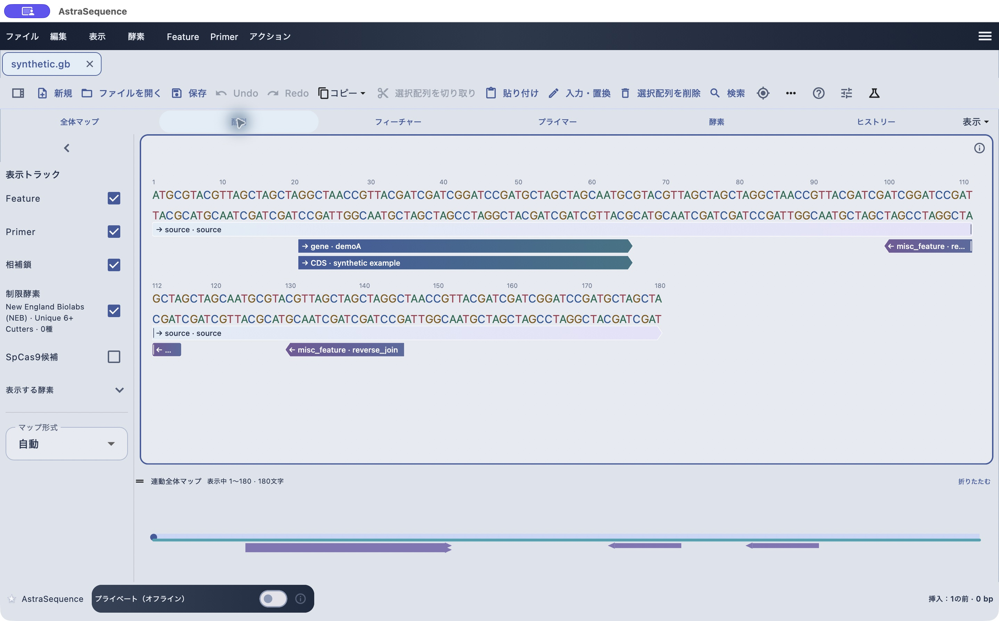

# まず配列を開き、選択して保存する

[目次へ](../README.md) · 対象：0.79.2 · 更新：2026-10-30

*0.79.2のmacOS実機。合成配列による操作例。*

このガイドはDNA・RNA・タンパク配列を扱う研究者向けです。初回はこの章と「保存・書き出し」を読み、その後は目的の章を参照してください。

1. アプリを起動し、「合成サンプルを開く」を押します。練習には内蔵サンプルを使えます。
2. 「配列」タブを押します。上段は保存された配列、DNAの下段は同じ座標の相補鎖です。
3. 配列の文字上をドラッグします。画面下部の選択開始・終了、長さ、GCを確認します。
4. 「コピー」から配列をコピーします。逆相補配列が必要ならコピーのメニューから指定します。
5. 「保存」を押し、完全保存形式の.asを選んで保存先を決めます。
6. 書類を閉じ、「ファイルを開く」から保存したファイルを開き直します。

自分のデータを使う場合は「ファイルを開く」で選択します。FASTAは主に配列、GenBankは配列と注釈を扱います。複数レコードのファイルでは文書内の配列切替も確認してください。名前が省略表示されている場合はマウスを重ねて全文を確認できます。

座標は原則1始まり・終了を含みます。21–65は45塩基です。挿入位置は塩基間の位置なので、選択範囲とは区別します。

次は[保存・書き出し](saving.md)へ進んでください。
