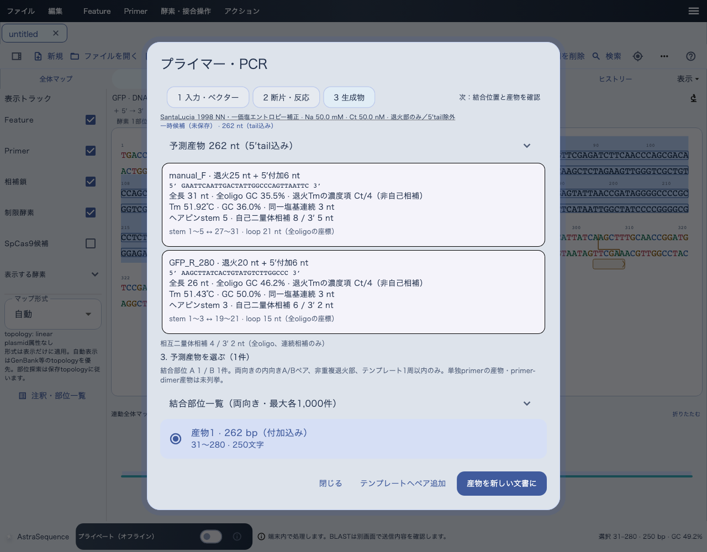

# Primerを登録し、PCR産物を確認する

[目次へ](../README.md) · 対象：0.84.0 · 更新：2026-11-05

Primerは保存するoligo配列と、鋳型上の結合位置を分けて確認します。鋳型に相補的に結合する部分を、画面では「テンプレート結合部」と表記します。5′側の付加配列（tail）はこれと区別します。oligoは常に5′→3′で扱います。

1. 鋳型となる配列を開きます。
2. 「Primer → oligo配列 → 配列 5′→3′から登録…」を選びます。範囲から登録する場合は、配列を選択して「Primer追加」を使います。
3. 名前、oligo配列、向き、結合位置、5′側の付加配列を確認します。
4. 適用し、「プライマー」タブで保存された注釈を確認します。
5. 「Primer → 候補ペア探索・評価・PCR…」でForward／Reverse候補と反応条件を設定します。
6. 結合位置と予測産物を確認し、必要な産物を新しい文書へ作成します。
7. Primerを登録した鋳型と生成物を、それぞれ.asで保存します。

Primerのコピーは「選択Primerのoligoをコピー（5′→3′）」を使います。配列ビューで選んだ鋳型領域のコピーとは、5′tailなどの扱いが異なります。

Tm・GC・二量体などの値は入力条件とモデルに依存します。複数の結合位置があるPrimerでは、意図した組合せの産物か確認してください。予測PCR産物は増幅成功や特異性の実験保証ではありません。

Primer・配列範囲の色はSnapGene互換の対応色から選びます。Featureの任意RGBとは選べる色の範囲が異なります。

*旧レイアウトの自動UIテストによる合成データの参考画像です。実機撮影ではありません。上部メニューは現行版と異なります。操作の入口は本文に記載した現行メニューを使ってください。*
