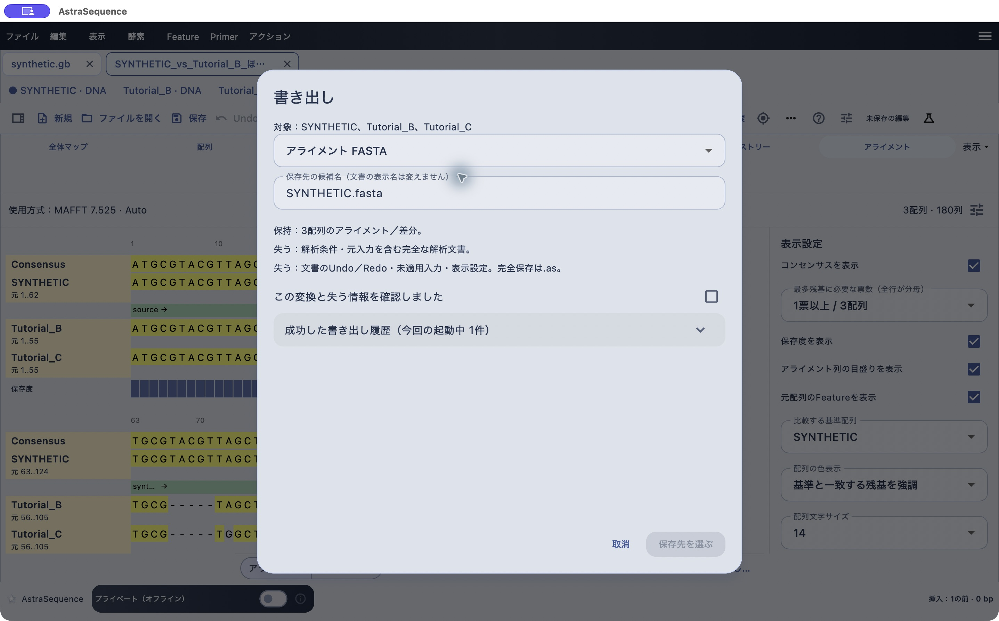

# 完全保存と外部形式への書き出し

[目次へ](../README.md) · 対象：0.79.2 · 更新：2026-10-30

*0.79.2のmacOS実機。合成配列による操作例。*

## 作業を再開するための保存

通常の配列文書は.as、アライメント文書は.asalnで保存します。「ファイル → 別名で保存…」では新しい名前と保存先を選べます。アライメントの計算条件、元配列、表示設定も残したい場合は.asalnを使います。

長い保存候補名は自動で短縮され、末尾に識別用の文字列が付与されます。文書内の元の配列名は保持されます。手入力した名前は自動短縮の対象外なので、OSが保存を受け付けない場合は短くしてください。

## 共同研究者へ渡す形式を選ぶ

1. 「ファイル → 書き出し（配列・アライメント・図）…」を開きます。
2. 対象と形式を確認します。
3. 「保持」と「失う」の説明を読みます。FASTAだけでは注釈や作業履歴を残せません。
4. 情報損失の確認欄にチェックし、「保存先を選ぶ」を押します。
5. 元の完全保存ファイルも手元に残します。

アライメント画面の「書き出し…」は交換用形式への入口です。画像には「完全保存は.as」と表示されています。アライメントの完全保存は、ファイルメニューの保存から.asalnを選んでください。既存.as文書の保存先は.asのままなので、形式を変える際は「別名で保存…」を使います。

Feature編集などの独立窓で、まだ「適用」していない下書きは保存・復旧対象に含まれません。先に適用し、その後に文書を保存してください。最近使ったファイルが再起動後に出ない場合は「ファイルを開く」で選び直します。
